  

  <a href="https://dev.nevcan.com"><picture><source media="(prefers-color-scheme: dark)" srcset="https://img.shields.io/badge/dev.nevcan.com-01050a?style=for-the-badge&logo=data%3Aimage%2Fsvg%2Bxml%3Bbase64%2CPHN2ZyB4bWxucz0iaHR0cDovL3d3dy53My5vcmcvMjAwMC9zdmciIHZpZXdCb3g9IjMxMCAyNTAgMjYwIDI3MCI%2BPHBhdGggZD0iTTM1MCAyODMgNTMzIDQ4NVYyODMiIGZpbGw9Im5vbmUiIHN0cm9rZT0iI2VlZjJmNSIgc3Ryb2tlLXdpZHRoPSI1NiIgc3Ryb2tlLWxpbmVjYXA9InJvdW5kIiBzdHJva2UtbGluZWpvaW49InJvdW5kIi8%2BPGNpcmNsZSBjeD0iMzUzIiBjeT0iNDc4IiByPSIzNCIgZmlsbD0iIzZmZjdlMCIvPjwvc3ZnPg%3D%3D&logoColor=6ff7e0"></picture></a>
  <a href="https://dive.nevcan.com"><picture><source media="(prefers-color-scheme: dark)" srcset="https://img.shields.io/badge/dive.nevcan.com-01050a?style=for-the-badge&logo=data%3Aimage%2Fsvg%2Bxml%3Bbase64%2CPHN2ZyB4bWxucz0iaHR0cDovL3d3dy53My5vcmcvMjAwMC9zdmciIHZpZXdCb3g9IjMxMCAyNTAgMjYwIDI3MCI%2BPHBhdGggZD0iTTM1MCAyODMgNTMzIDQ4NVYyODMiIGZpbGw9Im5vbmUiIHN0cm9rZT0iI2VlZjJmNSIgc3Ryb2tlLXdpZHRoPSI1NiIgc3Ryb2tlLWxpbmVjYXA9InJvdW5kIiBzdHJva2UtbGluZWpvaW49InJvdW5kIi8%2BPGNpcmNsZSBjeD0iMzUzIiBjeT0iNDc4IiByPSIzNCIgZmlsbD0iIzZmZjdlMCIvPjwvc3ZnPg%3D%3D&logoColor=6ff7e0"></picture></a>
  <a href="https://www.linkedin.com/in/nevcanuludas"><picture><source media="(prefers-color-scheme: dark)" srcset="https://img.shields.io/badge/LinkedIn-01050a?style=for-the-badge&logo=data%3Aimage%2Fsvg%2Bxml%3Bbase64%2CPHN2ZyB4bWxucz0iaHR0cDovL3d3dy53My5vcmcvMjAwMC9zdmciIHZpZXdCb3g9IjAgMCAyNCAyNCIgZmlsbD0iIzZmZjdlMCI%2BPGNpcmNsZSBjeD0iNSIgY3k9IjQuNSIgcj0iMi40Ii8%2BPHJlY3QgeD0iMyIgeT0iOC41IiB3aWR0aD0iNCIgaGVpZ2h0PSIxMi41IiByeD0iLjYiLz48cGF0aCBkPSJNOS41IDguNWgzLjh2MS44Yy44LTEuMyAyLjMtMi4yIDQuMy0yLjIgMy40IDAgNC45IDIuMSA0LjkgNS45VjIxaC00di02LjRjMC0xLjktLjYtMy0yLjEtMy0xLjYgMC0yLjcgMS4yLTIuNyAzLjFWMjFoLTQuMnoiLz48L3N2Zz4%3D&logoColor=6ff7e0"></picture></a>
  <a href="mailto:hello@nevcan.com"><picture><source media="(prefers-color-scheme: dark)" srcset="https://img.shields.io/badge/hello%40nevcan.com-01050a?style=for-the-badge&logo=data%3Aimage%2Fsvg%2Bxml%3Bbase64%2CPHN2ZyB4bWxucz0iaHR0cDovL3d3dy53My5vcmcvMjAwMC9zdmciIHZpZXdCb3g9IjAgMCAyNCAyNCIgZmlsbD0ibm9uZSIgc3Ryb2tlPSIjNmZmN2UwIiBzdHJva2Utd2lkdGg9IjIiIHN0cm9rZS1saW5lY2FwPSJyb3VuZCIgc3Ryb2tlLWxpbmVqb2luPSJyb3VuZCI%2BPHJlY3QgeD0iMi41IiB5PSI1IiB3aWR0aD0iMTkiIGhlaWdodD0iMTQiIHJ4PSIyLjUiLz48cGF0aCBkPSJtMy41IDYuNSA4LjUgNi41IDguNS02LjUiLz48L3N2Zz4%3D&logoColor=6ff7e0"></picture></a>

I've been building for the web since 2006: e-commerce at D&R, products at Doğuş Teknoloji, enterprise
software at SabancıDx. Today I'm co-founder & CTPO of [Dipnot](https://dipnot.app), running its
technology end to end as a one-person engineering team with AI-assisted development.

Underwater is the other half: I'm the only GUE instructor trainer in Türkiye, and my master's
thesis at Akdeniz University classifies Mediterranean amphorae with computer vision.

I love open source: my own sites are public at [nevcan-com](https://github.com/nevcan-com).

### Technologies & tools

| | |
| --- | --- |
| **Languages** | <picture><source media="(prefers-color-scheme: dark)" srcset="https://img.shields.io/badge/TypeScript-01050a?style=flat-square&logo=typescript&logoColor=6ff7e0"></picture> <picture><source media="(prefers-color-scheme: dark)" srcset="https://img.shields.io/badge/JavaScript-01050a?style=flat-square&logo=javascript&logoColor=6ff7e0"></picture> <picture><source media="(prefers-color-scheme: dark)" srcset="https://img.shields.io/badge/Python-01050a?style=flat-square&logo=python&logoColor=6ff7e0"></picture> <picture><source media="(prefers-color-scheme: dark)" srcset="https://img.shields.io/badge/HTML-01050a?style=flat-square&logo=html5&logoColor=6ff7e0"></picture> <picture><source media="(prefers-color-scheme: dark)" srcset="https://img.shields.io/badge/CSS-01050a?style=flat-square&logo=css&logoColor=6ff7e0"></picture> |
| **Web** | <picture><source media="(prefers-color-scheme: dark)" srcset="https://img.shields.io/badge/React-01050a?style=flat-square&logo=react&logoColor=6ff7e0"></picture> <picture><source media="(prefers-color-scheme: dark)" srcset="https://img.shields.io/badge/Next.js-01050a?style=flat-square&logo=nextdotjs&logoColor=6ff7e0"></picture> <picture><source media="(prefers-color-scheme: dark)" srcset="https://img.shields.io/badge/Astro-01050a?style=flat-square&logo=astro&logoColor=6ff7e0"></picture> <picture><source media="(prefers-color-scheme: dark)" srcset="https://img.shields.io/badge/Eleventy-01050a?style=flat-square&logo=eleventy&logoColor=6ff7e0"></picture> <picture><source media="(prefers-color-scheme: dark)" srcset="https://img.shields.io/badge/Tailwind%20CSS-01050a?style=flat-square&logo=tailwindcss&logoColor=6ff7e0"></picture> <picture><source media="(prefers-color-scheme: dark)" srcset="https://img.shields.io/badge/shadcn%2Fui-01050a?style=flat-square&logo=shadcnui&logoColor=6ff7e0"></picture> <picture><source media="(prefers-color-scheme: dark)" srcset="https://img.shields.io/badge/Three.js-01050a?style=flat-square&logo=threedotjs&logoColor=6ff7e0"></picture> |
| **Mobile** | <picture><source media="(prefers-color-scheme: dark)" srcset="https://img.shields.io/badge/React%20Native%20%C2%B7%20Expo-01050a?style=flat-square&logo=expo&logoColor=6ff7e0"></picture> <picture><source media="(prefers-color-scheme: dark)" srcset="https://img.shields.io/badge/Garmin%20Connect%20IQ-01050a?style=flat-square&logo=garmin&logoColor=6ff7e0"></picture> |
| **Back end & data** | <picture><source media="(prefers-color-scheme: dark)" srcset="https://img.shields.io/badge/Node.js-01050a?style=flat-square&logo=nodedotjs&logoColor=6ff7e0"></picture> <picture><source media="(prefers-color-scheme: dark)" srcset="https://img.shields.io/badge/Firebase-01050a?style=flat-square&logo=firebase&logoColor=6ff7e0"></picture> <picture><source media="(prefers-color-scheme: dark)" srcset="https://img.shields.io/badge/Supabase-01050a?style=flat-square&logo=supabase&logoColor=6ff7e0"></picture> <picture><source media="(prefers-color-scheme: dark)" srcset="https://img.shields.io/badge/FastAPI-01050a?style=flat-square&logo=fastapi&logoColor=6ff7e0"></picture> <picture><source media="(prefers-color-scheme: dark)" srcset="https://img.shields.io/badge/SQLite-01050a?style=flat-square&logo=sqlite&logoColor=6ff7e0"></picture> |
| **AI** | <picture><source media="(prefers-color-scheme: dark)" srcset="https://img.shields.io/badge/Claude%20API-01050a?style=flat-square&logo=claude&logoColor=6ff7e0"></picture> <picture><source media="(prefers-color-scheme: dark)" srcset="https://img.shields.io/badge/Computer%20vision-01050a?style=flat-square&logo=opencv&logoColor=6ff7e0"></picture> |
| **3D & imaging** | <picture><source media="(prefers-color-scheme: dark)" srcset="https://img.shields.io/badge/Metashape-01050a?style=flat-square&logo=data%3Aimage%2Fsvg%2Bxml%3Bbase64%2CPHN2ZyB4bWxucz0iaHR0cDovL3d3dy53My5vcmcvMjAwMC9zdmciIHZpZXdCb3g9IjAgMCAyNCAyNCIgZmlsbD0ibm9uZSIgc3Ryb2tlPSIjNmZmN2UwIiBzdHJva2Utd2lkdGg9IjEuOCIgc3Ryb2tlLWxpbmVqb2luPSJyb3VuZCI%2BPHBhdGggZD0iTTEyIDIuNSAyMC41IDd2MTBMMTIgMjEuNSAzLjUgMTdWN3oiLz48cGF0aCBkPSJNMy41IDcgMTIgMTEuNSAyMC41IDdNMTIgMTEuNXYxMCIvPjxwYXRoIGQ9Ik03LjggNC44IDE2LjIgOS4zTTE2LjIgNC44IDcuOCA5LjMiIHN0cm9rZS13aWR0aD0iMSIgb3BhY2l0eT0iLjU1Ii8%2BPC9zdmc%2B&logoColor=6ff7e0"></picture> <picture><source media="(prefers-color-scheme: dark)" srcset="https://img.shields.io/badge/Sketchfab-01050a?style=flat-square&logo=sketchfab&logoColor=6ff7e0"></picture> |
| **Quality** | <picture><source media="(prefers-color-scheme: dark)" srcset="https://img.shields.io/badge/Vitest-01050a?style=flat-square&logo=vitest&logoColor=6ff7e0"></picture> <picture><source media="(prefers-color-scheme: dark)" srcset="https://img.shields.io/badge/Jest-01050a?style=flat-square&logo=jest&logoColor=6ff7e0"></picture> <picture><source media="(prefers-color-scheme: dark)" srcset="https://img.shields.io/badge/Testing%20Library-01050a?style=flat-square&logo=testinglibrary&logoColor=6ff7e0"></picture> <picture><source media="(prefers-color-scheme: dark)" srcset="https://img.shields.io/badge/ESLint-01050a?style=flat-square&logo=eslint&logoColor=6ff7e0"></picture> <picture><source media="(prefers-color-scheme: dark)" srcset="https://img.shields.io/badge/Prettier-01050a?style=flat-square&logo=prettier&logoColor=6ff7e0"></picture> <picture><source media="(prefers-color-scheme: dark)" srcset="https://img.shields.io/badge/Ruff-01050a?style=flat-square&logo=ruff&logoColor=6ff7e0"></picture> |
| **Delivery** | <picture><source media="(prefers-color-scheme: dark)" srcset="https://img.shields.io/badge/Git-01050a?style=flat-square&logo=git&logoColor=6ff7e0"></picture> <picture><source media="(prefers-color-scheme: dark)" srcset="https://img.shields.io/badge/GitHub%20Actions-01050a?style=flat-square&logo=githubactions&logoColor=6ff7e0"></picture> <picture><source media="(prefers-color-scheme: dark)" srcset="https://img.shields.io/badge/GitHub%20Pages-01050a?style=flat-square&logo=githubpages&logoColor=6ff7e0"></picture> <picture><source media="(prefers-color-scheme: dark)" srcset="https://img.shields.io/badge/Vercel-01050a?style=flat-square&logo=vercel&logoColor=6ff7e0"></picture> |

### Stats & habits

  <picture><source media="(prefers-color-scheme: dark)" srcset="./metrics/stats.dark.svg"></picture>

  <picture><source media="(prefers-color-scheme: dark)" srcset="./metrics/snake.dark.svg"></picture>

  <picture><source media="(prefers-color-scheme: dark)" srcset="https://komarev.com/ghpvc/?username=nevcanuludas&label=profile%20views&color=01050a&style=flat-square"></picture>

